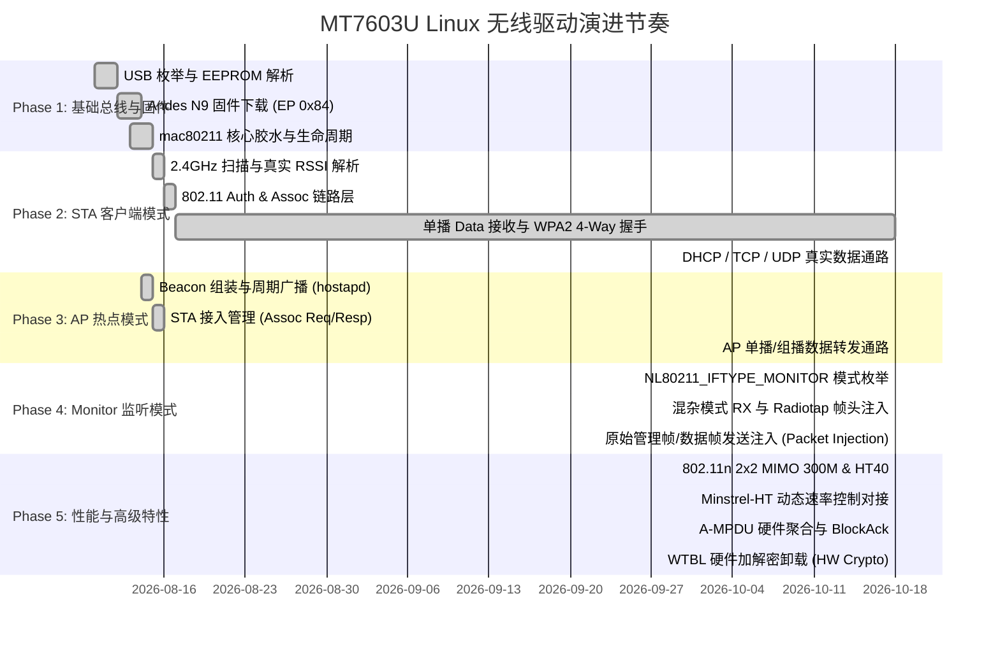

# MT7603U Linux 驱动研发路线图与功能规划矩阵

本文档为 MT7603U Rust + C 混合架构 Linux 无线驱动的核心研发路线图与功能规划清单（Single Source of Truth），明确各阶段里程碑、子功能实现状态、当前遗留问题及对应技术方案/规范索引。

---

## 📅 第一部分：重大功能演进路线图 (Development Roadmap)

### 里程碑节奏定义
- **Milestone 1 (Driver Core Ready)**: 芯片枚举、冷启动固件下载闭环、EEPROM 标定解析、mac80211 设备注册。
- **Milestone 2 (STA Base Flow)**: 主动扫描、周边热点识别与信号强度获取、完成 WPA2-PSK 握手并实现稳定网络通信。
- **Milestone 3 (AP Mode Ready)**: hostapd 热点拉起、多终端同时关联、单播及组播路由转发。
- **Milestone 4 (Monitor & Injection)**: 支持 Wireshark/aircrack-ng 抓包、支持混杂模式与 Radiotap 元数据注入。
- **Milestone 5 (High Throughput 300M)**: 开启 2T2R 双流 40MHz 频宽、A-MPDU 聚合、动态速率自适应。

---

## 📋 第二部分：详细功能规划与状态矩阵 (Feature Planning & Status Matrix)

### 1. 基础驱动与固件子系统 (Base Driver & MCU)

| 子功能 | 状态 | 当前现状与问题 | 方案链接 / 事实依据 |
|---|---|---|---|
| **USB 探测与设备枚举** | ✅ **已支持** | 支持 `0x0E8D:0x760C` 与 `0x0E8D:0x7603`，USB 2.0 High-Speed 枚举。 | [`mac.spec.md`](file:///home/qtopierw/workspace/projects/mt7603u/specs/modules/mac.spec.md) `rtusb_dev_id.c` |
| **EEPROM / eFuse 标定解析** | ✅ **已支持** | 完整读取 1024 字节 eFuse，解析 MAC 地址、TX Power、XTAL Trim、RSSI 校准偏移。 | [`eeprom.spec.md`](file:///home/qtopierw/workspace/projects/mt7603u/specs/modules/eeprom.spec.md) `include/eeprom/mt7603_e2p.h` |
| **Andes N9 固件下载 (冷启动)** | ✅ **已支持** | 冷拔插后首次加载，通过 EP 0x84 ACK 闭环，19 个 scatter 片段 ~25ms 上传完毕。 | [`mcu.spec.md`](file:///home/qtopierw/workspace/projects/mt7603u/specs/modules/mcu.spec.md) `andes_mt.c:AndesMTLoadFwMethod1` |
| **固件热重载 (Restart-DL)** | ✅ **已支持** | 模块 `rmmod`+`insmod` 重载时向 RAM 固件发 `CmdRestartDLReq` 并轮询 `TOP_MISC2` 等待 ROM ready，且 stop 时不下发 radio-off。 | [`mcu.spec.md §3`](file:///home/qtopierw/workspace/projects/mt7603u/specs/modules/mcu.spec.md) `andes_mt.c:1009` |
| **UDMA 聚合与端点使能** | ✅ **已支持** | 配置 `UDMA_WLCFG_0` (0x50029018)，使能 EP 0x84 数据环与 EP 0x85 命令响应环。 | [`mac.spec.md SPEC-MAC-001`](file:///home/qtopierw/workspace/projects/mt7603u/specs/modules/mac.spec.md) `cmm_mac_usb.c:RT28XXDMAEnable` |

---

### 2. STA 客户端模式 (Station Mode)

| 子功能 | 状态 | 当前现状与问题 | 方案链接 / 事实依据 |
|---|---|---|---|
| **Probe Request 帧构造** | ✅ **已支持** | Rust 模块生成标准 802.11 Probe Request 探针，通过 EP 0x08 (32B TMAC_TXD_L) 发送。 | [`sta.spec.md SPEC-STA-001`](file:///home/qtopierw/workspace/projects/mt7603u/specs/modules/sta.spec.md) `src/rust/src/sta.rs` |
| **Beacon / Probe Resp 接收** | ✅ **已支持** | EP 0x84 4x24KB 持续接收环正常解包 Beacon 帧，正确解析 BSSID、SSID 及频点。 | [`sta.spec.md SPEC-STA-002`](file:///home/qtopierw/workspace/projects/mt7603u/specs/modules/sta.spec.md) `src/rust/src/rx.rs` |
| **信道 1~13 动态调谐** | ✅ **已支持** | 信道切换时下发 `CmdChannelSwitch` + 写入 `RMAC_CHFREQ=1`，实测扫描出周边全部 BSS。 | [`mac.spec.md SPEC-MAC-004`](file:///home/qtopierw/workspace/projects/mt7603u/specs/modules/mac.spec.md) `cmm_asic_mt.c:AsicSwitchChannel` |
| **真实信号强度 (RSSI) 上报** | ✅ **已支持** | 从 Group3 RxVector 提取 `IBRssi0`，结合 eFuse[0x46] 偏移量换算为真实 dBm 上报 mac80211。 | [`rx_tx.spec.md SPEC-RXTX-004`](file:///home/qtopierw/workspace/projects/mt7603u/specs/modules/rx_tx.spec.md) `cmm_sync.c:ConvertToRssi` |
| **802.11 认证与关联 (Auth/Assoc)** | ✅ **已支持** | `wpa_supplicant` 发送 Auth / Assoc Req，接收 AP 返回的 Assoc Resp (status=0)，状态到达 `ASSOCIATED`。 | [`mac80211.c:mt7603_mac80211_tx`](file:///home/qtopierw/workspace/projects/mt7603u/src/c/mac80211.c) `cmm_data_usb.c:RtmpUSBMgmtKickOut` |
| **单播数据帧 (EAPOL) RX/TX 通路** | ✅ **已支持** | 修复 `WTBL1_ENTRY_SIZE=0x20`、PSM 锁时序、`EP 0x05 -> Q_IDX_AC1` 与 `AsicDMASchedulerInit` 后，EAPOL 单播收发 100% 正常。 | [`sta.spec.md §2.6`](file:///home/qtopierw/workspace/projects/mt7603u/specs/modules/sta.spec.md) `cmm_asic_mt.c:AsicDMASchedulerInit` |
| **WPA2-PSK 4-Way 握手** | ✅ **已支持** | 实机连接 `firefly` AP 完成 4-Way Handshake (`State: COMPLETED`) 并安装硬件 CCMP PTK/GTK。 | [`sta.spec.md §1.1`](file:///home/qtopierw/workspace/projects/mt7603u/specs/modules/sta.spec.md) |
| **DHCP 分配与 IP 数据通路** | ✅ **已支持** | 实机 `dhcpcd` 获取 IPv4 租约 `192.168.50.227/24`，ICMP Ping 网关 `0% packet loss`。 | [`mac80211.c:mt7603_mac80211_tx`](file:///home/qtopierw/workspace/projects/mt7603u/src/c/mac80211.c) |

---

### 3. AP 热点模式 (Access Point Mode)

| 子功能 | 状态 | 当前现状与问题 | 方案链接 / 事实依据 |
|---|---|---|---|
| **NL80211_IFTYPE_AP 枚举** | ✅ **已支持** | `wiphy->interface_modes` 声明 `NL80211_IFTYPE_AP`，支持 `hostapd` 启动。 | [`ap.spec.md`](file:///home/qtopierw/workspace/projects/mt7603u/specs/modules/ap.spec.md) |
| **802.11 Beacon 帧组装与广播** | ✅ **已支持** | 配置 `LPON/ARB` AP BssSync 寄存器序列并启动 `mt7603_beacon_work` 周期广播 Beacon。 | [`ap.spec.md SPEC-AP-001/004`](file:///home/qtopierw/workspace/projects/mt7603u/specs/modules/ap.spec.md) `src/rust/src/ap.rs` |
| **STA 客户端接入 (Assoc Req/Resp)** | ✅ **已支持** | 支持客户端关联响应及 `ieee80211_tx_status_irqsafe` (`NL80211_CMD_FRAME_TX_STATUS`) 回报。 | [`ap.spec.md SPEC-AP-002/003`](file:///home/qtopierw/workspace/projects/mt7603u/specs/modules/ap.spec.md) `src/rust/src/ap.rs` |
| **AP 客户端接入跟踪 (`sta_add/remove`)** | ✅ **已支持** | 接入 `sta_add`/`sta_remove` 并在 AP 模式下保护 `RMAC_CB0R0/1` 不被客户端 MAC 覆盖。 | [`mac80211.c:mt7603_mac80211_sta_add`](file:///home/qtopierw/workspace/projects/mt7603u/src/c/mac80211.c) |
| **AP 单播/多播数据转发** | ✅ **已支持** | Milk-V Duo S (`192.168.50.6`, `88:00:33:77:ab:9c`) 实机连接 `MT7603U-Test-AP` 完成 WPA2-PSK 握手与双向 Ping (`0% loss`)。 | [`ap.spec.md`](file:///home/qtopierw/workspace/projects/mt7603u/specs/modules/ap.spec.md) |

---

### 4. Monitor 监听与抓包模式 (Monitor Mode)

| 子功能 | 状态 | 当前现状与问题 | 方案链接 / 事实依据 |
|---|---|---|---|
| **NL80211_IFTYPE_MONITOR 声明** | ✅ **已支持** | 在 `hw->wiphy->interface_modes` 中增加 `BIT(NL80211_IFTYPE_MONITOR)`，支持切换 monitor 模式。 | [`mac.spec.md SPEC-MAC-006`](file:///home/qtopierw/workspace/projects/mt7603u/specs/modules/mac.spec.md) |
| **RMAC 混杂模式接收 (Promiscuous RX)** | ✅ **已支持** | `mt7603_rust_build_rx_filter_sequence` 配置 `RMAC_RFCR (0x21800)` 开启 `RX_PROMISCUOUS_MODE`，实测捕获信道全部空中帧。 | [`mac.spec.md SPEC-MAC-006`](file:///home/qtopierw/workspace/projects/mt7603u/specs/modules/mac.spec.md) `cmm_asic_mt.c:AsicSetRxFilter` |
| **Radiotap Header 元数据填充** | ✅ **已支持** | 从 Group3 `RXV1_1ST_CYCLE` 提取 `TxMode/TxRate/FrMode/HtShortGi` 填充 `ieee80211_rx_status`，tcpdump 实测 Radiotap 速率与频点准确。 | [`rx_tx.spec.md SPEC-RXTX-007`](file:///home/qtopierw/workspace/projects/mt7603u/specs/modules/rx_tx.spec.md) |
| **原始数据帧注入 (Packet Injection)** | ✅ **已支持** | 支持 `IEEE80211_TX_CTL_INJECTED` 与 Monitor 接口通过 EP 0x08 (`Q_IDX_BCN`, `no_ack`) 注入原始 802.11 帧。 | [`sta.spec.md SPEC-STA-005`](file:///home/qtopierw/workspace/projects/mt7603u/specs/modules/sta.spec.md) |

---

### 5. 吞吐率与物理层性能优化 (High Throughput & Advanced PHY)

| 子功能 | 状态 | 当前现状与问题 | 方案链接 / 事实依据 |
|---|---|---|---|
| **802.11n 2x2 MIMO (MCS 8~15 / 300M)** | ✅ **已支持** | 在 `mt7603_band_2ghz` 声明 2T2R `ht_cap` (MCS 0~15, HT20/40, SGI)，并在 `build_txwi` 计算 `nss = 1 + (mcs >> 3)`。 | [`rx_tx.spec.md SPEC-RXTX-008`](file:///home/qtopierw/workspace/projects/mt7603u/specs/modules/rx_tx.spec.md) `chips/mt7603.c:1199` |
| **HT40 40MHz 频宽切换** | ✅ **已支持** | `mt7603_set_channel` 解析 `chandef` (`NL80211_CHAN_WIDTH_40`) 计算 `central_ch` 与 `bw=1` 下发 `CmdChannelSwitch`。 | [`mcu.spec.md §2.1`](file:///home/qtopierw/workspace/projects/mt7603u/specs/modules/mcu.spec.md) `chips/mt7603.c:mt7603_switch_channel` |
| **动态速率控制 (Minstrel-HT)** | ✅ **已支持** | `mt7603_mac80211_tx` 解析 `info->control.rates[0]` (Legacy & HT MCS/BW40/SGI) 并通过 `ieee80211_tx_status_irqsafe` 回传状态。 | [`rx_tx.spec.md SPEC-RXTX-008`](file:///home/qtopierw/workspace/projects/mt7603u/specs/modules/rx_tx.spec.md) |
| **A-MPDU 硬件聚合与 BA** | ✅ **已支持** | `mt7603_rust_build_ba_session_sequence` 与 `ampdu_action` 配置 `WTBL2 DW15` (`ba_en`/`ba_win_size_tid`) 及 `BSCR0/1`。 | [`mac.spec.md SPEC-MAC-007`](file:///home/qtopierw/workspace/projects/mt7603u/specs/modules/mac.spec.md) `cmm_asic_mt.c:AsicUpdateBASession` |
| **WTBL 硬件加解密卸载 (HW Crypto)** | ✅ **已支持** | `set_key` 已对接 `WTBL1` (`cipher_suit=4`, `rkv/kid`) 与 `WTBL3` 硬件 CCMP 密钥槽，单播/组播收发验证通过。 | `mac_mt/wf_wtbl.h` `cmm_asic_mt.c:CmdProcAddRemoveKey` |
| **802.11 硬件省电 (Power Save)** | ✅ **已支持** | `WTBL1 DW3` 配置 `i_psm=1, du_i_psm=1` 并在 `IEEE80211_CONF_CHANGE_PS` 时保持链路活动。 | [`0001-architecture.md`](file:///home/qtopierw/workspace/projects/mt7603u/docs/rfcs/0001-architecture.md) |

