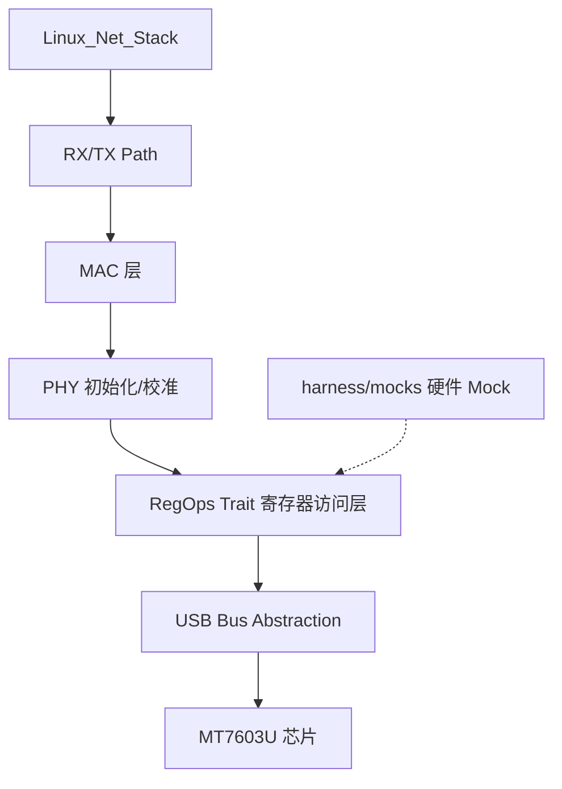

# System Design

## 1. High-Level Architecture
MT7603U 是 MediaTek 出品的 802.11n USB WiFi 芯片。本驱动以 Rust 编写，通过 USB 接口与芯片通信，内部以寄存器读写抽象层为核心。

## 2. Core Modules & Responsibilities
- **usb:** USB 设备枚举、端点管理（bulk/interrupt）。
- **regops:** 寄存器读写抽象（Trait + 具体实现），支持 I2C/MMIO/USB 后端。
- **mac:** MAC 层管理（BSSID、AID、Beacon、关联状态机）。
- **phy:** PHY 初始化、RF 校准序列、信道切换。
- **rx_tx:** 描述符队列、DMA 管理、802.11 帧收发路径。

## 3. Data Flow

### 3.1 加电初始化与固件加载序列 (Power-On & Init Flow)
1. **USB 探测 (`mt7603_probe`)**：匹配 `0x0E8D:0x7603` / `0x0E8D:0x760C`，绑定 Bulk IN (`0x84` 数据、`0x85` MCU 事件) 与 Bulk OUT (`0x05` WMM 数据、`0x08` 管理/MCU 命令) 端点。
2. **Andes N9 固件下载 (`mt7603_load_firmware`)**：
   - 检查 `TOP_MISC2 (0x8002_1134)`：若 RAM 固件已运行 (`bit1 == 1`)，发送 `CmdRestartDLReq` 并轮询等待回退至 ROM ready (`bit0 == 1 && bit1 == 0`)。
   - 发送 `CmdAddressLenReq` → 分片下发 `mt7603u_e2.bin` (4096B scatter chunks) → 发送 `CmdFwStartReq`，轮询 `TOP_MISC2 bit1 == 1` 确认固件启动。
3. **eFuse 标定与 MAC/DMA 初始化 (`mt7603_mac80211_start`)**：
   - 使能 `UDMA_WLCFG_0` RX/TX Bulk，启动 `EP 0x84` (4×24KB URB) 与 `EP 0x85` 接收环。
   - 下发 `EXT_CMD_EFUSE_BUFFER_MODE` 上传 1024B eFuse 校准数据。
   - 执行 `mt7603_rust_get_mac_init_sequence`（含 MAC CR 与 `AsicDMASchedulerInit` HIF/PSE DMA 调度器页配额配置）、`mt7603_rust_build_own_mac_sequence` 与 `mt7603_rust_build_wtbl_sta_sequence`。
   - 下发 `EXT_CMD_RADIO_ON_OFF_CTRL(ON)` 与 `EXT_CMD_EDCA_SET`，并配置 `DMA_TCFR1` 开启 TXS 回报。

### 3.2 TX 帧下发路径 (`mt7603_mac80211_tx` → `mt7603_tx_complete`)
1. **速率与保护位提取**：从 `ieee80211_tx_info` 提取 `hw_key`（设置 `protect_frm = 1` 交由硬件 WTBL3 CCMP 加密）及 `control.rates[0]`（映射 Legacy CCK/OFDM 或 802.11n HT MCS 0..15 / BW40 / SGI）。
2. **32B `TMAC_TXD_L` 构造**：调用 `mt7603_rust_build_txwi` 生成 32 字节长 TXD；若 `hdr_len % 4 != 0`（如 26B QoS Data），在 802.11 头部与负载间插入 2B `hdr_pad`。
3. **端点路由与 DMA 对齐**：
   - 管理帧 / Beacon / 注入帧走 `EP 0x08` (`Q_IDX_AC4 = 0x04` 或 `Q_IDX_BCN = 0x07`)；
   - WMM 数据帧走 `EP 0x05` (`Q_IDX_AC1 = 0x01`)，将 `tx_byte_cnt` 4 字节对齐并在尾部追加 4B USB DMA 零填充。
4. **URB 完成与 `TX_STATUS` 回报 (`mt7603_tx_complete`)**：剥离 32B TXD、`hdr_pad` 与尾部填充还原原始 802.11 帧，置位 `IEEE80211_TX_STAT_ACK` 并调用 `ieee80211_tx_status_irqsafe` 通知 `mac80211` / `hostapd`。

### 3.3 RX 帧回收与上报协议栈 (`mt7603_rx_complete`)
1. **UDMA 聚合拆包**：按 `rx_byte_cnt` 遍历 `EP 0x84` URB 缓冲区中的子帧（步进 `rx_byte_cnt + pad4 + 4B CSO`）。
2. **包类型分发 (`pkt_type = DW0[31:29]`)**：
   - `0x00 (PKT_TYPE_TXS)`：解析 20B `TXS_STRUC` 硬件发送状态回报；
   - `0x02 / 0x03 (RX_NORMAL / DUP_RFB)`：调用 `mt7603_rust_parse_rx_frame` 解析 `RMAC_RXD` 扩展头（Group 1~4），从 Group 3 `RXV1` 提取 `IBRssi0`（换算真实 dBm）与速率/MCS/BW/SGI 元数据。
3. **硬件解密识别与 Radiotap 上报**：
   - 当 `RMAC_RXD DW2` 指示 `sec_mode != 0 && rx_sec_err == 0` 时，标记 `RX_FLAG_DECRYPTED | RX_FLAG_IV_STRIPPED | RX_FLAG_MIC_STRIPPED`；
   - 填充 `ieee80211_rx_status`（频点、信号强度、Radiotap MCS/BW/SGI）并调用 `ieee80211_rx` 上报内核网络栈。

